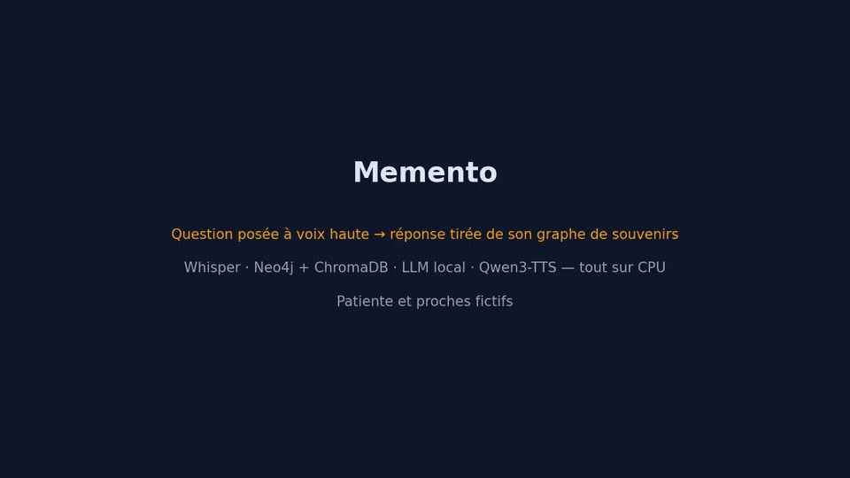
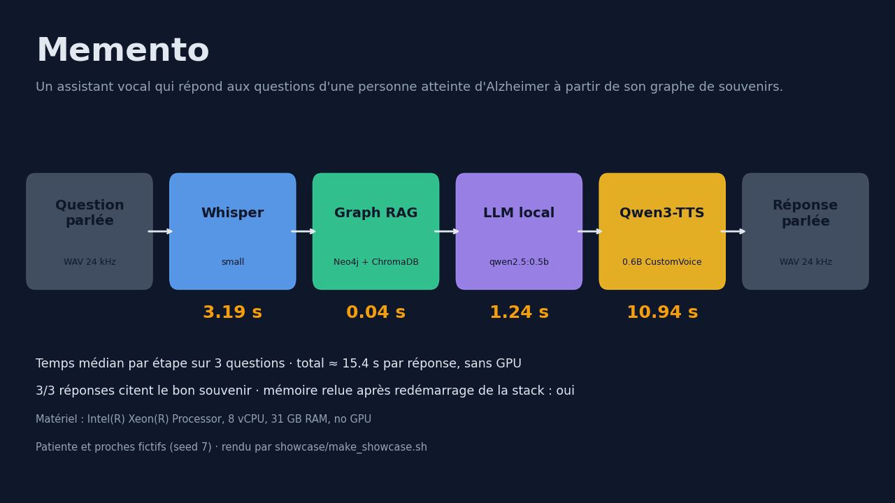
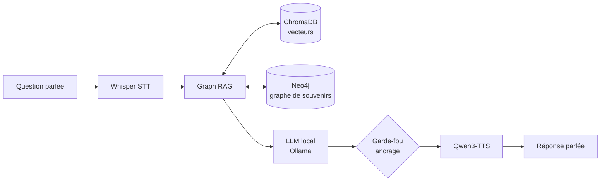

# Memento

Assistant vocal local, sans écran ni bouton, qui répond aux questions d'une personne atteinte d'Alzheimer à partir de son propre graphe de souvenirs (proches, lieux, routines, événements datés) — pour les aidants, les familles et les équipes qui construisent des aides cognitives.



*Rejoue un run réel enregistré par `showcase/make_showcase.sh` (version avec le son : [`showcase/demo.mp4`](showcase/demo.mp4)). Patiente et proches fictifs.*

```bash
docker compose up -d && docker compose exec ollama ollama pull qwen2.5:0.5b   # Neo4j + ChromaDB + LLM local
uv sync --all-extras && uv run python -m memento.demo seed                    # charge la patiente fictive dans les vrais stores
uv run python -m memento.demo ask "Qui vient déjeuner avec moi le dimanche ?"
```

## Résultats clés

Mesurés par `bash showcase/make_showcase.sh` · 3 questions parlées, patiente fictive (seed 7) · Intel Xeon 8 vCPU, 31 GB RAM, **sans GPU**.

| Mesure | Valeur |
|---|---|
| Réponses qui citent le bon souvenir (voix → voix) | **3/3** |
| Même réponse depuis la mémoire stockée après redémarrage de Neo4j, ChromaDB et Ollama | **oui** (`MEMENTO_STACK_TESTS=1 uv run pytest -m stack`) |
| Aller-retour vocal médian sur CPU | **15,4 s** |
| Whisper `small` (transcription) | 3,19 s |
| Graph RAG Neo4j + ChromaDB (récupération + contexte) | 0,04 s |
| LLM `qwen2.5:0.5b` via Ollama | 1,24 s |
| Qwen3-TTS 0.6B (synthèse de la réponse) | 10,94 s |
| Tests unitaires (`uv run pytest`) | 106 passés, 1 test de stack réel opt-in |



## Comment ça marche



Les aidants remplissent un graphe personnel (`PatientMemorySnapshot`) écrit dans Neo4j et indexé dans ChromaDB. La question transcrite par Whisper récupère les souvenirs pertinents avec un score clinique explicable ; le LLM répond uniquement à partir de ce contexte ; un garde-fou remplace toute réponse qui cite des noms ou des faits absents de la mémoire ; Qwen3-TTS lit la réponse.

### Démo de bout en bout (`python -m memento.demo`)

| Commande | Effet |
|---|---|
| `snapshot` | affiche le graphe fictif généré (seed fixe) |
| `seed` | l'écrit dans Neo4j + ChromaDB |
| `ask "…"` | répond à une question texte depuis les stores |
| `questions` | synthétise les questions en WAV avec Qwen3-TTS (sans micro) |
| `roundtrip` | WAV → Whisper → graph RAG → LLM → TTS, enregistre réponses audio, transcriptions et temps |
| `persistence` | pose la question, redémarre la stack, la repose |

Les variables `NEO4J_URI`, `CHROMA_PORT`, `MEMENTO_LLM_BASE_URL`, `MEMENTO_LLM_MODEL`… (voir `src/memento/demo/stack.py`) permettent de viser un autre LLM compatible OpenAI.

## Détails

Memento est une prothèse cognitive vocale destinée aux patients atteints de la maladie d'Alzheimer. L'idée centrale est simple : donner au patient un accès permanent, à portée de voix, à sa propre mémoire personnelle. Un compagnon vocal qui connaît ses proches, ses habitudes, ses souvenirs et ses routines, et peut y répondre à tout moment de manière naturelle et rassurante, sans écran, sans bouton, sans aucune interaction cognitive requise.

La mémoire du patient est alimentée de deux façons : par les aidants et la famille via une application dédiée, et de manière automatique en captant le contexte des interactions quotidiennes (visites, conversations, émotions) avec le consentement de chacun. Ce contexte vivant est stocké dans un graphe de mémoire personnalisé et affectif, bien au-delà de ce que peut offrir n'importe quel assistant généraliste.

Le projet vise à réduire les moments de confusion et d'angoisse, à préserver l'autonomie le plus longtemps possible, et à soulager les aidants. Dans un second temps, une couche visuelle, idéalement via des lunettes connectées, permettra à l'assistant de reconnaître les visages en temps réel et d'enrichir encore davantage le contexte de chaque interaction.

### Architecture du pipeline

```
Microphone
    ↓
Whisper + VAD  (Speech-to-Text local)
    ↓
LlamaIndex  (orchestration RAG)
    ↓
ChromaDB ←→ Neo4j  (index sémantique ↔ graphe de mémoire)
    ↓
LLM local compatible OpenAI (Ministral 3 8B visé ; qwen2.5:0.5b pour la démo CPU)
    ↓
Qwen3-TTS  (Text-to-Speech voix clonée)
    ↓
Haut-parleur
```

### Fonctionnement de la memoire

La memoire suit une logique knowledge graph + recherche semantique.

1. Ingestion:
- l'application compose un `PatientMemorySnapshot`
- le snapshot est d'abord normalise/reconcilie (`reconcile_snapshot`) pour traiter doublons et conflits de saisie
- le snapshot est synchronise via `MemorySyncEngine.sync_snapshot(...)`
- le moteur met a jour en parallele, dans une transaction explicite graph/index:
    - le graphe patient (relations explicites)
    - l'index semantique (recuperation contextuelle)
- chaque transaction peut etre journalisee (WAL JSONL) et rejouee au redemarrage (`auto_recover=True`)

2. Recuperation:
- `MemorySyncEngine.recall(...)` retrouve des souvenirs pertinents
- l'hydratation graphe est calculee en passe unique pour limiter la latence quand `top_k` augmente
- avec `Neo4jGraphStore`, les contextes des candidats sont recuperes en batch (`batch_recall_context`)
- les souvenirs archives sont filtres par defaut (option `include_archived=True` pour les reinclure)
- une couche emotionnelle ajuste dynamiquement les poids cliniques (agitation, tristesse, calme)
- les hits sont reclasses avec un score clinique explicable (`score_breakdown`)
- `MemorySyncEngine.reorientation_context(...)` produit un contexte de reassurance pret a etre injecte dans la reponse vocale

Voir la documentation detaillee de la couche memory:
- `src/memento/memory/README.md`

### Chemin de la donnee

Chemin ecriture:

`PatientMemorySnapshot`
-> reconciliation d'entree
-> projection graphe
-> ecriture `GraphStore`
-> projection documents
-> ecriture `SemanticIndex`

Chemin lecture:

`question patient`
-> recherche semantique
-> enrichment graphe en passe unique
-> scoring explicable
-> contexte de reorientation
-> generation de reponse vocale

### Orchestration conversationnelle

La couche conversationnelle relie la memoire au modele de generation.

Boucle executee:

`question patient`
-> `MemorySyncEngine.reorientation_context(...)`
-> injection du contexte patient dans le prompt
-> generation du texte assistant
-> trace des souvenirs utilises

Le contexte injecte contient notamment:

- l'identite du patient
- les reperes rassurants (`anchors`)
- les notes de soin (`care_notes`)
- les proches de confiance
- les routines immediates
- les souvenirs recuperes et leurs signaux de ranking

L'orchestrateur actuel utilise `ConversationOrchestrator.respond(...)` pour:

- recuperer le `PatientReorientationContext`
- construire un prompt utilisateur avec ce contexte memoire
- appeler un backend de generation
- retourner la reponse, le contexte et la trace de retrieval

Exemple minimal:

```python
from memento import (
    ConversationGeneration,
    ConversationMessage,
    ConversationOrchestrator,
    MemorySyncEngine,
)


class FakeConversationBackend:
    def generate(self, messages, *, model_name, temperature):
        return ConversationGeneration(
            text="Claire vient dimanche pour le dejeuner.",
            model_name=model_name,
        )


engine = MemorySyncEngine()
engine.sync_snapshot(snapshot)

orchestrator = ConversationOrchestrator(
    memory_engine=engine,
    backend=FakeConversationBackend(),
)

response = orchestrator.respond(
    "rose",
    "Qui vient dimanche ?",
)

print(response.answer)
print(response.context.patient_display_name)
print(response.trace.retrieved_memories)
```

### Runtime bout-en-bout

Le depot contient maintenant un runtime live qui chaine:

`micro -> VAD streaming -> Whisper -> memory -> LLM -> Qwen TTS -> speaker`

Pieces ajoutees:

- backend LLM HTTP compatible OpenAI:
  - `OpenAICompatibleConversationBackend`
- runtime live:
  - `MementoRuntime`
- bootstrap depuis un snapshot JSON:
  - `python -m memento.runtime`

Le backend conversationnel vise un endpoint compatible `/v1/chat/completions`
(par exemple un serveur local expose en mode OpenAI-compatible).

Exemple minimal de snapshot JSON:

```json
{
  "patient": {
    "patient_id": "rose",
    "display_name": "Rose Martin",
    "preferred_name": "Mamie Rose",
    "care_notes": ["Rassurer avant de recontextualiser."],
    "anchors": ["Appartement rue des Lilas"]
  },
  "people": [
    {
      "person_id": "claire",
      "name": "Claire Martin",
      "relationship_to_patient": "sa fille",
      "notes": "Vient le dimanche.",
      "emotional_significance": 0.95
    }
  ],
  "places": [],
  "routines": [],
  "episodes": []
}
```

Lancement du runtime:

```bash
uv run python -m memento.runtime \
  --snapshot-file ./patient_snapshot.json \
  --llm-base-url http://127.0.0.1:11434/v1 \
  --llm-model "Ministral 3 8B"
```

Options utiles:

- `--microphone-device`
- `--speaker-device`
- `--whisper-device cpu|cuda`
- `--tts-speaker`
- `--disable-interrupt-on-speech`
- `--max-frames` pour un smoke test court

### Front runtime React

Le runtime dispose maintenant d'un front React avec une grande sphere centrale, une capture micro navigateur, un fallback texte, et une integration HTTP vers le pipeline Python.

Lancer l'API runtime :

```bash
uv run python -m memento.runtime.web \
  --snapshot-file ./patient_snapshot.json \
  --host 127.0.0.1 \
  --port 8000
```

Lancer le front React :

```bash
cd frontend/runtime-react
npm install
npm run dev
```

Le front permet de regler :

- l'URL de l'API runtime
- le snapshot patient JSON
- l'endpoint LLM compatible OpenAI
- le modele Whisper
- la configuration Qwen TTS

### Comment tester

#### Installer l'environnement

```bash
uv sync --all-extras
```

#### Lancer les tests unitaires

```bash
uv run python -m pytest
```

#### Tester la transcription micro avec Streamlit

```bash
uv run streamlit run experimentations/streamlit_whisper_app.py
```

Ensuite :
- autoriser l'acces au microphone dans le navigateur
- enregistrer une phrase avec le bouton de capture
- cliquer sur `Transcribe`
- lire la transcription mot par mot puis la transcription complete

Notes :
- le depot est maintenant configure par defaut pour `Whisper large-v3`
- au premier lancement, `openai-whisper` peut telecharger le modele choisi
- `large-v3` sur `cpu` fonctionne, mais le chargement initial et l'inference peuvent etre lents
- la capture micro temps reel utilise `sounddevice`
- `ffmpeg` reste necessaire pour les transcriptions depuis un fichier audio, mais le flux micro capture en memoire n'en depend pas
- le mode `cuda` avec `fp16` est recommande si une GPU compatible est disponible
- les modeles `tiny`, `base` ou `small` restent utiles pour des essais rapides
- le projet pinne maintenant `torch` sur l'index PyTorch `cu128` pour eviter qu'un `uv sync` reinstalle un build CPU-only

#### Tester le TTS avec Streamlit

Installer d'abord le runtime local recommande pour `Qwen/Qwen3-TTS-12Hz-1.7B-CustomVoice` :

```bash
uv pip install -U qwen-tts
```

Ensuite lancer le labo TTS :

```bash
uv run streamlit run experimentations/streamlit_tts_app.py
```

Notes :
- la doc officielle Qwen recommande le package Python `qwen-tts`
- le modele `Qwen/Qwen3-TTS-12Hz-1.7B-CustomVoice` se charge localement via `Qwen3TTSModel.from_pretrained(...)`
- `Synthese seulement` genere un preview audio dans le navigateur
- `Synthese + server speaker` joue sur les haut-parleurs de la machine qui execute Streamlit
- le front expose `speaker`, `langue` et `instruction` pour le mode `CustomVoice`
- le chemin `wav` reste le plus simple pour les essais locaux

#### Utiliser la restitution vocale

Verifier d'abord que `qwen-tts` et ses dependances runtime sont installes.

Exemple minimal :

```python
from memento import (
    DEFAULT_QWEN_TTS_LANGUAGE,
    DEFAULT_QWEN_TTS_MODEL_NAME,
    DEFAULT_QWEN_TTS_SPEAKER,
    QwenTTSBackend,
    SoundDeviceOutput,
    SpeakerPlayer,
    SpeechSynthesizer,
    TextToSpeechConfig,
    VoiceResponsePipeline,
)

tts_config = TextToSpeechConfig(
    model_name=DEFAULT_QWEN_TTS_MODEL_NAME,
    voice_id=DEFAULT_QWEN_TTS_SPEAKER,
    language=DEFAULT_QWEN_TTS_LANGUAGE,
    response_format="wav",
    instruction="Parle calmement et rassure la personne.",
)

pipeline = VoiceResponsePipeline(
    synthesizer=SpeechSynthesizer(
        backend=QwenTTSBackend(config=tts_config),
        config=tts_config,
    ),
    player=SpeakerPlayer(device=SoundDeviceOutput()),
)

result = pipeline.speak("Bonjour Charles, je suis la pour t'aider.")
print(result.metrics.end_to_end_latency_ms, result.meets_targets)
```

## Roadmap et limites connues

- Sur CPU, la synthèse vocale domine la latence (~11 s pour une phrase courte) ; un GPU ou un TTS plus léger est nécessaire pour un échange naturel.
- `qwen2.5:0.5b` ajoute parfois des détails mal ancrés ; le garde-fou tolère un mot inconnu, donc une petite erreur (une heure) peut passer.
- Une seule patiente fictive ; aucune évaluation clinique n'a été menée.
- Le mode micro live (`python -m memento.runtime`) et le front React ne sont pas exercés par le run du showcase.
- Le CI n'est pas encore en place : les dépendances `torch` CUDA rendent l'installation lourde sur un runner standard.
